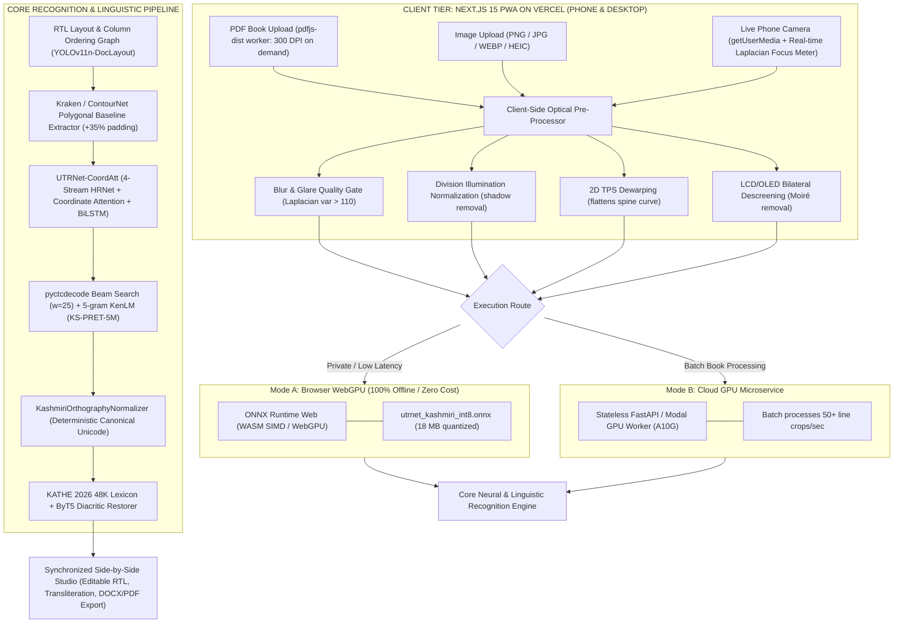

# Production Camera-to-Unicode OCR & Vercel Web App Architecture for Printed Kashmiri (Nastaliq Script)

**Version:** 2.0 (Production Release)  
**Target Environment:** Vercel Serverless (Next.js 15 PWA) + Client-side ONNX WebGPU / WASM + Stateless GPU Worker (Modal / Hugging Face Spaces)  
**Scripts Supported:** Kashmiri Perso-Arabic (Nastaliq, Gulmarg Nastaleeq, Awami Nastaliq, Afan Koshur Naksh)  
**Input Formats:** Multi-page PDF Books (300 DPI client render), Uploaded Images (PNG/JPG/WEBP/HEIC), Live Phone Camera Viewfinder  

---

## 1. Executive Critique: Why the Initial Pipeline Fails in Production & How v2.0 Fixes It

Deploying a real-world web application that processes multi-page physical book PDFs, uploaded images, and live smartphone camera photos of printed and screen-rendered Kashmiri exposes seven critical production bottlenecks. Below is how the v2.0 Enhanced Architecture systematically resolves each one:

| # | Bottleneck in v1.0 Pipeline | Why It Breaks in Real Camera / PDF / Vercel Use | v2.0 Production Engineering Fix |
|---|-----------------------------|-------------------------------------------------|---------------------------------|
| **1** | **Vercel Serverless Limits (250 MB Bundle, 4.5 MB Payload, 10s–60s Timeout, No GPU)** | PyTorch + Kraken + SwinIR exceed 2 GB, crashing Vercel builds. Uploading a 50 MB book PDF directly to a Vercel API route triggers `413 FUNCTION_PAYLOAD_TOO_LARGE` or times out after page 2. | **Split Edge-Client + Quantized ONNX WebGPU / Cloud Worker Architecture:** Render PDF pages and rectify camera photos client-side in the browser (`pdfjs-dist` + Canvas/OpenCV.js), and run INT8-quantized ONNX Runtime Web (`onnxruntime-web` WebGPU/WASM) or stream cropped line batches (~40 KB WebP) to a stateless GPU inference endpoint (Modal / Hugging Face Spaces / Replicate). |
| **2** | **Curved Book Pages (3D Cylindrical Spine Curl) vs. Flat 2D Homography** | When a user snaps a photo of an open physical book (like *Kāśir Lug̲h̲at*), pages curve into the spine. A 4-point perspective homography only fixes flat tilts—leaving curved baselines that slice through Nastaliq diacritics. | **2D Thin-Plate Spline (TPS) Dewarping + Sauvola/Division Illumination Normalization:** Replace simple 4-point homography with a lightweight cubic baseline TPS mesh dewarper and Adaptive Division Illumination Normalization ($I_{\text{norm}} = \text{clip}\left(\frac{I}{\text{GaussianBlur}(I, \sigma=45) + \epsilon} \times 240, 0, 255\right)$) to flatten curved book spines and remove mobile flash glare and hand shadows without eroding 1–2px diacritics. |
| **3** | **Multi-Column & Dictionary Layout Blindness** | Dictionaries, textbooks, and newspapers have 2–3 RTL columns, headers, page numbers, and Bilingual (English/Urdu/Kashmiri) entries. Feeding a full width line across two columns scrambles the reading order. | **RTL Layout & Column Reading-Order Graph (YOLOv11n-DocLayout):** Segment page into structural zones (`header`, `column_rtl`, `marginalia`, `page_num`) and sort polygons strictly Right-to-Left across columns, Top-to-Bottom within each column before line extraction. |
| **4** | **Screen Moiré & Subpixel Artifacts on Monitor Photos** | Snapping a phone photo of a laptop or phone screen introduces high-frequency LCD/OLED Moiré interference grids that look like false nuqtas (dots) or sukun marks to an HRNet backbone. | **Frequency-Domain Notch / Bilateral Descreening + Moiré Augmentation:** Add an automatic bilateral descreening pass on input photos, and add synthetic RGB subpixel & sinusoidal Moiré grids to `SynthCamera-KS` training data (30% of lines). |
| **5** | **Intra-Word Non-Joining Gaps (PAsCs) vs. True Word Spaces** | Non-joining letters (ا, د, ڈ, ر, ڑ, ز, ژ, و, ۄ) create visual breaks inside words, while Nastaliq kerning tucks the next word under the previous descending stroke (ے, ں), causing CTC greedy decoding to merge words or split single words. | **Explicit Space-Token Supervision + Shallow KenLM 5-Gram Beam Search:** Train CTC with distinct visual kerning distributions and decode using `pyctcdecode` backed by a 5-gram Kashmiri character/word KenLM language model built from [KS-PRET-5M](https://kashmirairesearch.online/resources) and the [Kaeshir Dictionary](https://github.com/izan-majeed/kaeshir-dictionary-data) to enforce valid word boundaries. |
| **6** | **Canonical Unicode & Double-Diacritic Ordering Chaos** | In Kashmiri onset clusters (ترٛومُت, برَْگ), a medial consonant carries both a jazm (U+0652 / U+065B) and a vowel diacritic. Inconsistent code-point ordering during training causes CTC loss oscillation. | **Strict Canonical Grapheme Ordering (`KashmiriOrthographyNormalizer`):** Enforce a deterministic code-point emission order (Base Consonant $\to$ Medial Sukun U+0652 $\to$ Shadda U+0651 $\to$ Primary Vowel Diacritic $\to$ Nasalization) on all training labels and post-OCR outputs. |
| **7** | **Missing Interactive Verification & Export Workflow** | Raw OCR text without visual line alignment makes proofreading a 300-page book painful. | **Synchronized Side-by-Side Canvas Viewer + Editable RTL Studio:** Highlight the exact polygon on the scanned page as the user hovers or edits the corresponding Unicode line, with 1-click Copy, `.txt`, `.docx`, `.json`, and searchable `.pdf` export. |

---

## 2. Enhanced End-to-End v2.0 Pipeline Architecture

---

## 3. Deep-Dive: Enhancements to Each Pipeline Stage

### Enhancement 1: Multi-Input Pre-Processing (PDFs, Curved Books, and Screen Photos)

#### PDF Vector vs. Raster Routing
When a user uploads a PDF book in the Vercel app, each page is analyzed client-side via `pdfjs-dist`:
- If the PDF already contains embedded fonts or legacy InPage non-Unicode PUA glyphs, we extract text and remap via a lookup table.
- For scanned image PDFs, each page is rendered to an offscreen `<canvas>` at 300 DPI ($\text{scale} = \frac{300}{72} \approx 4.167$) one page at a time using an isolated Web Worker. This guarantees that a 500-page dictionary never exceeds browser memory limits or triggers Vercel payload errors.

#### Shadow-Proof Illumination Normalization
Standard binarization (Otsu, Sauvola) destroys 1–2 pixel Kashmiri diacritical marks like:
- Arabic Hamza Below (`◌ٕ`, U+0655)
- Kashmiri Wavy Dagger (`◌ٟ`, U+065F)
- The subscript ring on Kashmiri Yeh (`ؠ`, U+0620)

Instead, v2.0 computes a smooth 2D Gaussian background illumination map $B(x,y) = \text{GaussianBlur}(I(x,y), \sigma=45)$ and computes:
$$I_{\text{norm}}(x,y) = \text{clip}\left(\frac{I(x,y)}{B(x,y) + 10^{-5}} \times 240, 0, 255\right)$$
This removes heavy smartphone hand shadows and warm incandescent indoor tints while retaining subtle grayscale anti-aliasing around minuscule diacritic dots.

#### 2D Thin-Plate Spline (TPS) Curve Rectification
When a physical book curves into the spine, cubic polynomials are fitted along the top and bottom text margins:
$$y_{\text{top}}(x) = a_0 + a_1 x + a_2 x^2 + a_3 x^3$$
A Thin-Plate Spline (TPS) grid transformation shifts the curved coordinate lattice back into rectangular lines before slicing polygonal text strips.

---

### Enhancement 2: SynthCamera-KS v2.0 Dataset Generator

To ensure the neural recognition network generalizes equally well to pristine scans, mobile camera snapshots, and monitor photos:

1. **Font & Typography Matrix**:
   - 500,000 synthetic line images rendered with Pango and HarfBuzz (`--lang=ks` enabled).
   - Fonts used: `Noto Nastaliq Urdu v3.002+`, `Gulmarg Nastaleeq`, `SIL Awami Nastaliq`, `Mehr Nastaliq`, `Afan Koshur Naksh`.
   - Variable font sizes: 16pt to 48pt.
   - Variable inter-word kerning ($0.6\times$ to $1.5\times$ base space width) to teach CTC blank vs. space tokens.
2. **Physical Book Track (50% of synthetic samples)**:
   - Cylindrical sine-wave baseline warps: $y' = y + A \sin\left(\frac{\pi x}{W}\right)$.
   - 3D perspective keystoning ($\pm 15^\circ$).
   - Parabolic 2D illumination gradients and soft penumbra hand cast shadows.
   - Gaussian blur ($\sigma \in [0.5, 1.8]$) and Poisson sensor noise.
3. **Screen Photo Track (30% of synthetic samples)**:
   - LCD/OLED RGB subpixel vertical stripe overlays: alternating $[R, G, B]$ columns.
   - High-frequency sinusoidal Moiré interference patterns:
     $$M(x,y) = 0.5 + 0.5 \sin(2\pi (f_x x + f_y y) + \phi), \quad f \in [0.15, 0.35] \text{ cycles/px}$$

---

### Enhancement 3: High-Resolution Recognition Architecture (`UTRNet-CoordAtt`)

Standard CRNNs downsample feature maps vertically to $H=1$ or $H=2$, merging horizontally adjacent Kashmiri ligatures and destroying vertically stacked diacritics.

`UTRNet-CoordAtt` resolves this with:
1. **4-Stream HRNet Backbone**: Maintains parallel high, medium, and low-resolution feature representations (64px, 32px, 16px, 8px) with continuous multi-scale fusion.
2. **Vertical-Preserving Stride (2,1)**: The second strided convolution uses stride $(2,1)$ instead of $(2,2)$, preserving $H/2 = 32\text{ px}$ height in the highest resolution branch.
3. **Coordinate Attention (CoordAtt)**:
   Unlike SE-Net channel attention, Coordinate Attention embeds spatial position by decomposing channel pooling into horizontal and vertical directions:
   $$z^h_c(h) = \frac{1}{W} \sum_{0 \le i < W} x_c(h, i), \quad z^w_c(w) = \frac{1}{H} \sum_{0 \le j < H} x_c(j, w)$$
   This explicitly correlates a consonant tooth at coordinate $(x, y_{\text{base}})$ with a floating diacritic at $(x, y_{\text{diacritic}})$.
4. **Sequence Modeling**: 2-layer Deep BiLSTM (hidden size = 512, dropout = 0.3) followed by a 98-class Linear projection and CTC Loss.

---

### Enhancement 4: Canonical Kashmiri Unicode Normalization Table

To prevent CTC loss oscillation and eliminate cursor bugs during editing, all text passes through strict canonical normalization:

$$\text{[Base Letter]} + \text{[Medial Sukun } (\text{U+0652})\text{]} + \text{[Shadda } (\text{U+0651})\text{]} + \text{[Primary Vowel Diacritic]} + \text{[Nasalization } (\text{نْ / ں})\text{]}$$

| Orthographic Feature | Legacy / Input Code-Point | Enforced Canonical Unicode Sequence | Hex Sequence |
|---|---|---|---|
| Short mid-front vowel /e/ | `ێ` (U+06CE) | `یٚ` (medial) / `ےٚ` (final) | `\u06CC\u065A` / `\u06D2\u065A` |
| Short mid-back vowel /o/ | `ۆ` (U+06C6) | `وٚ` | `\u0648\u065A` |
| Long high-central vowel /ɨː/ | `ٳ` (U+0673 deprecated) | `اٟ` (initial) / `◌ٟ` (medial) | `\u0627\u065F` / `\u065F` |
| Short high-central vowel /ɨ/ | Misplaced Hamza | `◌ٕ` (Arabic Hamza Below) | `\u0655` |
| Mid-central vowels /ə/ & /əː/ | `ۀ` (U+06C0) | `◌ٔ` (Hamza Above) for /ə/; `ٲ` (Alef with Maddah Above) for /əː/ | `\u0654` / `\u0672` |
| Open-mid back vowels /ɔ/ & /ɔː/ | `ۅ` (U+06C5 Kirghiz Waw) | `ۄ` (Waw with Ring) for /ɔ/; `ۄا` for /ɔː/ | `\u06C4` / `\u06C4\u0627` |
| Palatalization /ʲ/ | `ۍ` (U+06CD) or `ی࣑` | `ؠ` (Arabic Letter Kashmiri Yeh) | `\u0620` |
| Arabic Kaf to Persian/Kashmiri Keheh | `ك` (U+0643) | `ک` (U+06A9) | `\u06A9` |
| Arabic Ya to Farsi/Urdu Yeh | `ي` (U+064A) | `ی` (U+06CC) | `\u06CC` |
| Consonant cluster tr- / kr- | U+065B African mark | `ر` + `◌ْ` (U+0652 Jazm, renders inverted-V in `--lang=ks`) | `\u0631\u0652` |

---

### Enhancement 5: KenLM Shallow Fusion Beam Search

Word boundaries are determined by decoding CTC frame probabilities with `pyctcdecode` fused with a 5-gram KenLM language model:

$$\hat{Y} = \arg\max_{Y} \left( \log P_{\text{CTC}}(Y \mid X) + \alpha \log P_{\text{KenLM}}(Y) + \beta \vert{}Y\vert{}_{\text{words}} \right)$$

where $\alpha = 0.5$ and $\beta = 1.2$. This enforces that non-joining medial breaks in words like `آزاد` (`آ` + `ز` + `ا` + `د`) remain a single word, while tightly kerned distinct words like `یہِ مکان` are separated by a space.

---

## 4. Full-Stack Next.js 15 PWA Architecture & Vercel Configuration

The frontend is built with Next.js 15 App Router, TypeScript, and Tailwind CSS.

### File Structure:
- `app/page.tsx`: Unified Studio with 3 input drawers, side-by-side interactive verification canvas, diacritic toolbar, live romanizer, and simulator tab.
- `app/api/ocr/route.ts`: Vercel edge/node API route handling line crops, forwarding to GPU worker with graceful client-side fallback.
- `lib/kashmiri-normalizer.ts`: Client-side canonical Kashmiri Unicode normalizer.
- `lib/laplacian-focus.ts`: Client-side Web Worker calculating image sharpness from Laplacian variance ($> 110$).
- `lib/export-utils.ts`: Exporters for TXT, DOCX, JSON, and Searchable PDF.
- `public/manifest.json`: Full PWA manifest for offline installation on Android/iOS.
